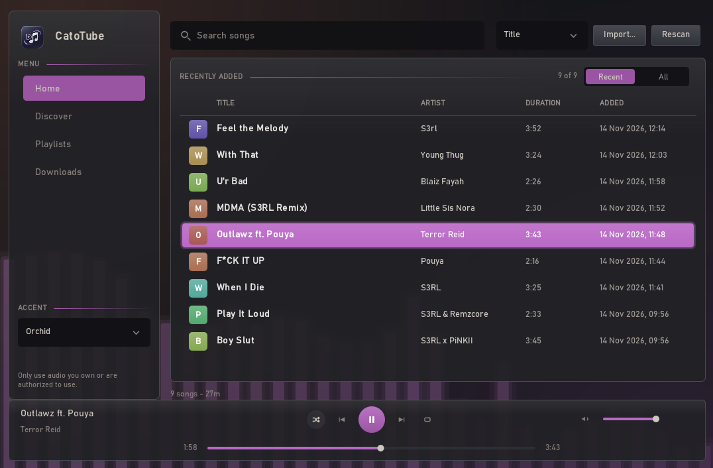
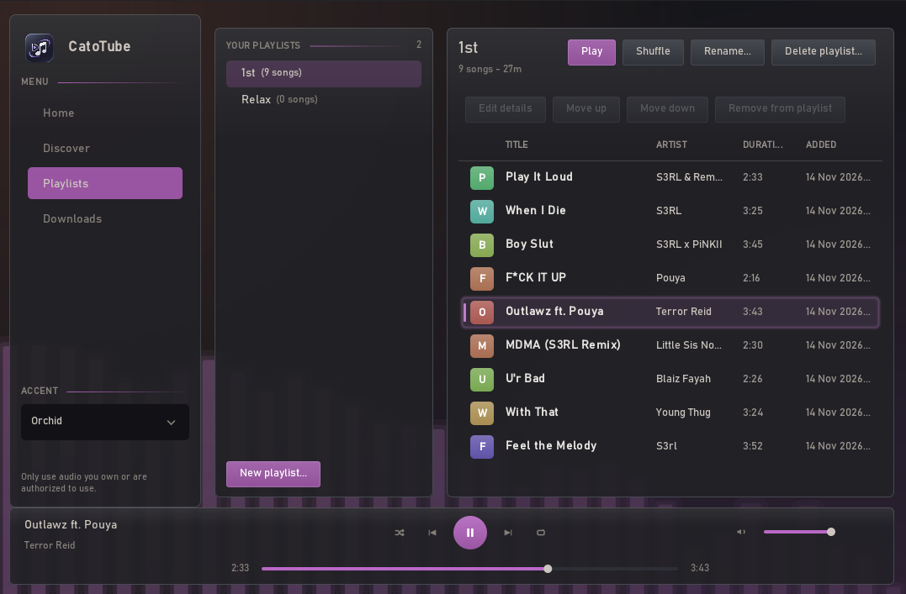

# CatoTube

CatoTube is an open source desktop app that saves a single YouTube video's audio as an MP3 in a music library on your own computer. You search or paste a link, the song downloads in seconds, and then it lives on your disk. Play it, build playlists, and listen with no internet connection.

CatoTube is not a streaming app. It does not play music from YouTube. Every song is downloaded once and played from your library.





## Features

- **Downloads in seconds.** Paste a single-video link or search YouTube from the app. Most songs download and convert to MP3 in seconds, then appear in your library.
- **Works offline.** Once a song is downloaded, it plays from your disk. No account, no stream, no buffering.
- **A real music library.** Search, sort by title, artist, duration, or date added, and keep the library in a folder you choose.
- **Playlists.** Create, rename, and reorder playlists. Play or shuffle a whole playlist.
- **A full player.** Play, pause, next, previous, shuffle, repeat, seek, mute, and volume.
- **A window that feels alive.** The song that is playing glows and pulses with the music, and a background visualizer follows the audio.
- **Your accent color.** Pick the highlight color from the sidebar. It is remembered between runs.
- **High-quality MP3.** Encoding uses FFmpeg's highest quality VBR setting (`-V 0`). The source quality still depends on what YouTube provides.

## Requirements

- JDK 25 (the Gradle build pins toolchain 25)
- `yt-dlp` on `PATH`
- `ffmpeg` on `PATH` (used for MP3 conversion and playback)
- `ffprobe` on `PATH` (reads song durations; it ships with FFmpeg)
- `deno` on `PATH` (the JavaScript challenge solver used by yt-dlp)

CatoTube does not bundle these tools. On Windows, install them with WinGet from PowerShell:

```powershell
winget install --source winget --id yt-dlp.yt-dlp
winget install --source winget --id Gyan.FFmpeg
winget install --source winget --id DenoLand.Deno
```

The FFmpeg package includes `ffprobe`. Close and reopen CatoTube after installing so Windows supplies the updated `PATH`.

CatoTube checks these four tools every time it starts. If one is missing, a setup dialog lists each tool with its install command and a Copy button. The same status is printed in the command-line mode.

## Build and run

Build the standalone JAR from the project directory:

```powershell
./gradlew.bat :app:jar
```

The file is `app/build/libs/app-all.jar`. It bundles the app and its JVM dependencies. `yt-dlp`, `ffmpeg`, `ffprobe`, and `deno` stay separate and must be on `PATH`.

Double-click `app-all.jar` to open the window, or run it from a terminal:

```powershell
javaw -jar .\app\build\libs\app-all.jar
```

`java -jar` attaches to the console and starts the command-line mode instead of the window.

To build a Windows app folder with its own Java runtime:

```powershell
./gradlew.bat :app:packageWindows
```

The output is `app/build/installer/CatoTube/CatoTube.exe`. Running the app folder needs no separate Java install, because the folder includes its own runtime. Start it from that folder, or pin it to the taskbar or Start menu. The folder contains the JVM and the app only, so `yt-dlp`, `ffmpeg`, `ffprobe`, and `deno` must still be on `PATH`. To share the app, zip the `CatoTube` folder. Windows SmartScreen may warn about an unsigned build.

For development, you can also run the app through Gradle:

```powershell
./gradlew.bat :app:run
```

## Using CatoTube

The first time you open the app, choose a library folder. The library keeps its index in `library.json` and copies downloaded songs into a `songs` folder. Original files are never moved or changed.

- **Home** lists your full library by default. Choose Recent to show the 10 most recently added songs; search and sort are also available. Double-click a song, or select it and press Enter, to play it. Right-click a song to play it next, add it to the queue or a playlist, open its file location, edit its details, or remove it from the library.
- **Discover** searches YouTube. Click the plus at the right of a result, or right-click it, to download it or to download it and add it to a playlist. Downloads run one at a time, and a song already in your library is not downloaded again. Searching alone never downloads anything.
- **Playlists** lists your playlists on the left. Play starts a playlist from the top, and Shuffle plays it in random order. Select a playlist to reorder its songs with Move up and Move down, or remove a song from it. Removing a song from a playlist never deletes the audio file. Deleting a playlist keeps its songs in the library.
- **Queue** shows the song that is playing and the songs that play next. The tab shows how many songs are queued, and it glows while the queue has songs. Double-click a song, or select it and press Enter, to play it now. Move up, Move down, Remove, and Clear queue change only the queue. They never touch a playlist or the library.
- **Downloads** takes a single-video URL from `youtube.com` or `youtu.be`. Playlist links are rejected. The MP3 is saved to the folder shown under "Save to".
- **Bottom bar** controls playback and stays visible on every page. While a download runs, a ring on the right shows its percentage. Click the ring to cancel the download after confirming.
- **Accent** (bottom of the sidebar) changes the highlight color.

Playback decodes with FFmpeg, so it plays every format FFmpeg reads, including MP3, WAV, FLAC, and Opus.

## Network notes

CatoTube forces IPv4 for yt-dlp requests. On the development machine, YouTube returned quickly over IPv4 while IPv6 connections timed out. Using IPv4 cut the extraction of a test clip from a long stall to about six seconds. This setting is local to CatoTube and does not change Windows networking.

## Use it responsibly

Only download audio you own or have permission to use. Check YouTube's terms before you download or use any audio. CatoTube does not bypass access controls, and it does not download playlists.

## Open source

CatoTube is open source. Read the code, report issues, or build your own version:

- Source: https://github.com/ucwxcato/cato-tube
- License: [MIT](LICENSE)
